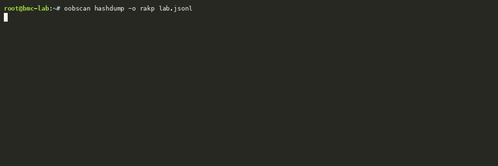
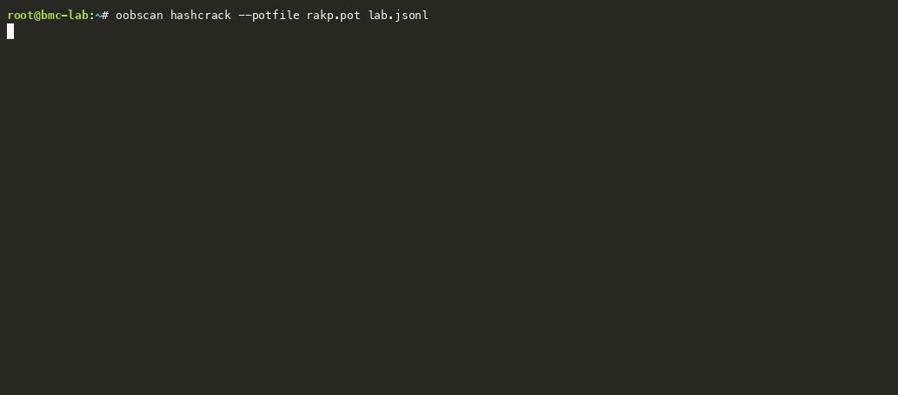
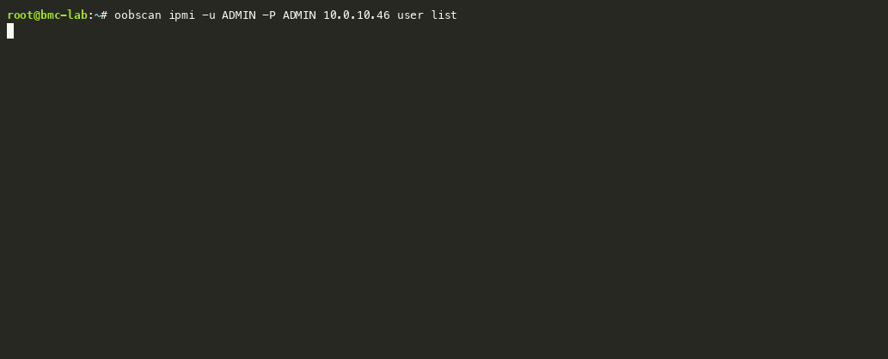

# OOBscan

> A security assessment and diagnostic tool for out-of-band management.

OOBscan enumerates BMCs, serial-port servers, IP-KVMs, PDUs, and other
out-of-band management services to identify exposures, validate remediation,
and support authorized incident investigation. It provides:

- Reproducible implementations of the findings in the "Lights Out" research
  and accompanying [security advisories](#research-and-disclosures).
- Network inventory and exposure assessment to help operators prioritize fixes.
- Manual protocol diagnostics for IPMI and vendor-specific management operations.

## Demonstrations


### Scan a management network

Discover and assess BMCs and other out-of-band devices across multiple subnets.








<details>
<summary><strong>Explore seven more workflows</strong></summary>

### Export RAKP audit inputs

Prepare captured weak hashes for authorized offline audits with hashcat or John.


### Crack weak RAKP hashes

Audit captured RAKP hashes against vendor defaults and operator-supplied candidates.


### Generate a validation guide

Turn findings into scoped validation and remediation guidance.


### Build an offline report

Generate a self-contained HTML exposure report from a redacted corpus.


### Validate the Supermicro RAKP bypass

Probe for the ATEN unordered-RAKP authentication bypass without opening a session.


### Validate ATEN privilege escalation

Probe whether a reserved RAKP role can inherit Administrator privileges.


### Inspect BMC users over IPMI

Use a recovered weak credential to review account status and privilege levels.


</details>

## Research and disclosures

The [Lights Out: The server in your server, exposed and disclosed](https://www.runzero.com/blog/lights-out-exposed/)
research post is the main guide to this project and its findings. Related public
presentations include [Black Hat USA 2026](https://blackhat.com/us-26/briefings/schedule/#lights-out-bmcs-are-still-broken-and-now-we-have-the-receipts-53926)
and [DEF CON 34](https://defcon.org/html/defcon-34/dc-34-speakers.html#content_66635).
See also the earlier [BMC research rapid response](https://www.runzero.com/blog/bmc-research/),
the [Lenovo XCC2 CVE-2024-38508 follow-up](https://www.runzero.com/blog/cve-2024-38508-lenovo/),
and the complete [runZero advisory index](https://www.runzero.com/advisories/).

CVEs covered by the Lights Out research and follow-up:

- **OpenBMC:** [CVE-2026-16140](https://www.runzero.com/advisories/openbmc-ipmi-privsec-rakp-cve-2026-16140/),
  [CVE-2026-16141](https://www.runzero.com/advisories/openbmc-ipmi-auth-bypass-rakp-cve-2026-16141/)
- **Lenovo XCC2:** [CVE-2024-38508](https://www.cve.org/CVERecord?id=CVE-2024-38508)
- **HPE iLO:** [CVE-2026-65204](https://www.runzero.com/advisories/hpe-ilo-preauth-overflow-ssh-cve-2026-65204/),
  [CVE-2026-65205](https://www.runzero.com/advisories/hpe-ilo-ipmi-session-injection-cve-2026-65205/),
  [CVE-2026-65206](https://www.runzero.com/advisories/hpe-ilo-type-confusion-cve-2026-65206/),
  [CVE-2026-65207](https://www.runzero.com/advisories/hpe-ilo-truncated-json-unicode-escape-dos-cve-2026-65207/),
  [CVE-2026-65208](https://www.runzero.com/advisories/hpe-ilo-json-dispatcher-mutex-leak-cve-2026-65208/),
  [CVE-2026-65209](https://www.runzero.com/advisories/hpe-ilo-redfish-nested-json-dos-cve-2026-65209/)
- **Huawei openUBMC:** [CVE-2026-65198](https://www.runzero.com/advisories/huawei-default-snmpv3-usm-key-cve-2026-65198/),
  [CVE-2026-65199](https://www.runzero.com/advisories/huawei-openubmc-snmp-privsec-cve-2026-65199/),
  [CVE-2026-65200](https://www.runzero.com/advisories/huawei-malicious-device-integer-underflow-cve-2026-65200/)
- **H3C HDM:** [CVE-2026-65197](https://www.runzero.com/advisories/h3c-hdm-firmware-verification-key-replacement-cve-2026-65197/)
- **Vertiv Avocent:** [CVE-2026-65184](https://www.runzero.com/advisories/avocent-acs8000-wsserver-cmdinj-cve-2026-65184/)
- **Dell iDRAC:** [CVE-2026-65185](https://www.runzero.com/advisories/dell-idrac-pldm-bof-cve-2026-65185/),
  [CVE-2026-65186](https://www.runzero.com/advisories/dell-idrac10-sqli-cve-2026-65186/),
  [CVE-2026-65187](https://www.runzero.com/advisories/dell-idrac9-xrc4-underflow-cve-2026-65187/),
  [CVE-2026-65188](https://www.runzero.com/advisories/dell-idrac9-ipmi-bof-cve-2026-65188/),
  [CVE-2026-65189](https://www.runzero.com/advisories/dell-idrac-redfish-sqli-cve-2026-65189/),
  [CVE-2026-65190](https://www.runzero.com/advisories/dell-idrac9-sso-dos-cve-2026-65190/),
  [CVE-2026-65191](https://www.runzero.com/advisories/dell-idrac9-ssrf-cve-2026-65191/),
  [CVE-2026-65192](https://www.runzero.com/advisories/dell-idrac10-telemetry-exposure-cve-2026-65192/),
  [CVE-2026-65193](https://www.runzero.com/advisories/dell-idrac9-maser-update-cve-2026-65193/),
  [CVE-2026-65194](https://www.runzero.com/advisories/dell-idrac-tls-key-cve-2026-65194/),
  [CVE-2026-65195](https://www.runzero.com/advisories/dell-idrac10-predictable-password-cve-2026-65195/),
  [CVE-2026-65196](https://www.runzero.com/advisories/dell-idrac10-ipv6-ipmi-cve-2026-65196/)
- **Supermicro:** [CVE-2026-18449](https://www.runzero.com/advisories/smc-rakp-key-cve-2026-18449/),
  [CVE-2026-18450](https://www.runzero.com/advisories/smc-ipmi-auth-bypass-cve-2026-18450/),
  [CVE-2026-18451](https://www.runzero.com/advisories/smc-kvm-token-cve-2026-18451/),
  [CVE-2026-65210](https://www.runzero.com/advisories/smc-fileread-cve-2026-65210/),
  [CVE-2026-65211](https://www.runzero.com/advisories/smc-memaccess-cve-2026-65211/),
  [CVE-2026-65213](https://www.runzero.com/advisories/smc-cmdinj-cve-2026-65213/),
  [CVE-2026-65219](https://www.runzero.com/advisories/smc-rakp-bypass-cve-2026-65219/),
  [CVE-2026-65220](https://www.runzero.com/advisories/smc-priv-esc-cve-2026-65220/)

## Status

Pre-release. Interfaces under `pkg/` may change before the first stable tag.
Security-sensitive findings are coordinated with affected vendors before public
documentation is expanded.

## Authorized use and operational safety

Run OOBscan only against systems you own or have explicit permission to assess.
Agree on target scope, credentials, rate limits, and maintenance windows before
testing production or OT networks. Read-only requests can still affect fragile
management controllers; no scan mode guarantees zero operational impact.

`scan` sends active network probes and enables default-credential checks by
default. `--disable-logins` suppresses active login checks, not discovery,
protocol requests, or RAKP hash collection. It is **not a passive scan mode**.
Use `--checks`, `--categories`, and `--workers` to limit an assessment. Deep IPMI
enumeration and the full OpenBMC user-key search require explicit opt-in.
SNMP write-access validation can send a same-value SET. Although it preserves
the observed value, firmware may still log the write or apply configuration.

Manual commands can change accounts, reset a BMC, access host memory, or alter
hardware state. Read each command's help before use. An `apply` gate is a
confirmation of execution, not a substitute for authorization; raw IPMI and
some administrative operations execute immediately.

Scan records, configuration backups, hash exports, potfiles, and reports can
contain credentials, authentication material, and identifying device data.
Restrict access and retention. Review even redacted output before sharing it.

## Build

```console
$ go build -o oobscan .
```

## Commands

`scan` runs the identify -> checks -> credentials pipeline for each target.
The remaining commands analyze stored results or perform explicitly selected
diagnostic and administrative operations. Some manual commands accept multiple
targets; review the expanded scope before making changes.

```console
# Scan and inventory
$ oobscan scan        # comprehensive per-target pipeline (identify -> checks -> creds)
$ oobscan coverage    # print the OOB device/vendor inventory + registered check map
$ oobscan version

# Work with scan results (read a scan's *.jsonl)
$ oobscan convert     # normalize a corpus into oobscan JSONL; redact or audit it
$ oobscan replay      # re-run the record-pure detection logic over a corpus; diffable table
$ oobscan report      # build an interactive HTML exposure report (one or many corpora)
$ oobscan hashcrack   # audit disclosed IPMI RAKP hashes offline (SHA1/MD5/SHA256)
$ oobscan hashdump    # export hashcat / John input files from RAKP hashes
$ oobscan explain     # render a markdown findings guide from a scan

# Authorized diagnostics and administration
$ oobscan ipmi        # ipmitool-like IPMI command runner (mc/chassis/lan/fru/user/sol/raw/mem/...)
$ oobscan redfish     # authenticated Redfish OEM operations
$ oobscan xdp         # Intel ASD / H3C RemoteXDP JTAG client

# Supermicro/ATEN OEM workflows (session-backed commands share `ipmi` flags)
$ oobscan smc-backup           # export + decrypt the BMC configuration archive
$ oobscan smc-restore-shell    # stage a certificate-authenticated stunnel break-glass shell
$ oobscan smc-uninstall        # remove supported shell and legacy service launchers
$ oobscan smc-shell            # connect to a deployed stunnel shell for investigation
$ oobscan smc-read             # CVE-2026-65210 read a BMC file over the OEMHW1 file handler
$ oobscan smc-cdb              # enumerate controllers / send SCSI CDBs
$ oobscan smc-rakp-bypass      # validate CVE-2026-65219 (ATEN RAKP authentication bypass)
$ oobscan smc-priv-esc         # validate CVE-2026-65220 (ATEN RAKP privilege escalation)
$ oobscan smc-x14-cmdinj       # validate CVE-2026-65213 (X14 RestorePSOOBBFile injection)
$ oobscan smc-alert-cmdinj     # investigate ATEN alert injection (unconfirmed, no CVE)
$ oobscan smc-kvm              # validate CVE-2026-18451 (Supermicro X13 iKVM token disclosure)
```

### Break-glass investigation

`smc-restore-shell` stages a certificate-authenticated stunnel root shell for
authorized investigation. `--apply` commits the configuration and reboots the
BMC; staging alone still uploads an archive to the device. The launcher persists
in the BMC configuration, although the running service uses temporary storage.
There is no unauthenticated Telnet fallback and no tailnet agent deployment.

The service pins a client certificate. The client does not verify the BMC's
server certificate and permits legacy TLS for firmware compatibility, so use a
trusted, restricted management path. Protect the client key, remove access when
the investigation is complete, and verify cleanup on the device. `smc-uninstall`
retains cleanup support for recognized legacy launchers; it is not a factory reset
or a guarantee that every separately installed agent artifact has been removed.

`oobscan convert` rewrites a corpus as native oobscan JSONL. It reads its own
output (migrating older records to the current rules) and the two runZero export
shapes (`--format rzsql`, `--format rzservices`), preserving every source
attribute and deriving the oobscan identity/findings/RAKP view on top. Two
transforms are available in the same pass: `--redact`, which renumbers addresses
and removes identifying values to prepare a corpus for review, and `--quality`,
the contributor-facing QA audit for data-hygiene and coverage regressions
(formerly the `scanaudit` command).

`oobscan replay <corpus>` is the regression harness for that same logic. It
streams a corpus and re-evaluates everything that is a pure function of a stored
record -- the audit rules (contradiction detector, proof predicates,
silent-partial, binary-body, mangled-bytes, duplicate collapse), record
migration, and, on a runZero corpus, the finding emitters -- then prints one
tab-separated, key-sorted table. Build two binaries, replay the same corpus with
each, and `diff` the tables to see exactly which counts a change moved;
`--hosts <key>` prints the hosts behind one row so `comm` shows which hosts
gained or lost it, and `--field <check[.field]>` reports how much a field's value
actually varies. Nothing in `replay` opens a socket, so a change to a probe or a
live check cannot be measured this way -- that still needs a scan.

`oobscan report -o <dir> [Name=]<file.jsonl> ...` builds a self-contained,
offline-capable HTML report from one or more oobscan NDJSON corpora. (Point it
at oobscan output; run a runZero export through `oobscan convert` first.) Naming
two or more sources (`Internal=a.jsonl External=b.jsonl`) adds a cross-source
comparison that judges populations on prevalence (% of each source) while
showing absolute counts. The HTML contains overview slides and aggregate
vendor, firmware, service, finding, and IPMI/RAKP views, not per-host rows or
addresses. Review aggregates before distribution because small populations can
still disclose sensitive information.

Unless `--no-artifacts` is supplied, the output directory also contains per-source
hash exports and overview, exposure, IPMI, SNMP, and vendor CSVs. These artifacts
can include recovered passwords and authentication material. `--potfile` marks
RAKP hashes recovered by an offline audit. Inputs produced by `convert --redact`
are identified as redacted; review the full output directory before sharing it.

Beyond the CLI, the scanner's building blocks -- GUID decoding, TLS shared-key
matching, and the per-protocol probes -- are also importable **library packages**
under `pkg/`; see [Using OOBscan as a library](#using-oobscan-as-a-library).

### How `scan` works

`scan` takes targets as arguments or via `-i` (file / `-` for stdin): single IPs,
hostnames, CIDRs (`10.0.0.0/24`), hyphen ranges (`10.0.0.1-20`), `host:port`, or
an **IPv6 link-local sweep** (`ff02::1%en0`, see below).
It fans out one **panic-isolated goroutine per host** (default 512, `-w`) and runs
a fixed pipeline on each:

1. **identify** -- probe IPMI/HTTP/TLS/Redfish/iLO/iDRAC/Lantronix/Moxa/..., fuse the
   signals into a device class + vendor + product (`pkg/identify`).
2. **device-specific checks** -- checks scoped to the identified vendor/class.
3. **cross-vendor / class checks** -- including established exposures: outdated
   libupnp via SSDP (CVE-2012-5958/5959), SNMP default community (`public`), SSH
   banner fingerprint + default-credential login, and the Supermicro `/PSBlock`
   cleartext credential store on TCP/49152 (CVE-2014-8272).
4. **`--ipmi-full`** (opt-in) -- walk the entire IPMI NetFn/Cmd/IPMB surface and
   run the slow Track B/C/D research sweeps (session-ID correlation, OEM NetFn
   reachability, IPMB satellite discovery). These are excluded from the default
   scan to keep it fast; the default runs the fast exposure checks only.
5. **`--ipmi-null-priv`** (opt-in, implied by `--ipmi-full`) -- when Get Channel
   Auth Caps advertises an enabled null or anonymous account, open an RMCP+
   session as it and **measure** the privilege it actually holds. The advertised
   bit is a configuration statement, not an impact statement: an account can be
   enabled yet clamped to privilege 0 with IPMI messaging off, unable to read
   sensors, FRU, the SEL, or even Get Device ID. Without the measurement
   `ipmi.authNull`/`ipmi.authAnon` stay LOW; a measured USER privilege or above
   raises them.

The interactive view shows progress, finding counts, and active phases.
`-v`/`--verbose` adds per-target and per-check logging on stderr. Ctrl-C cancels
the scan, flushes buffered output, and exits.

Default credentials are checked automatically for BMCs: a disclosed RAKP-2 hash
is tested **offline** against the vendor-prioritized credential database. That
offline computation cannot cause account lockouts. A capped **online** RAKP-3/4
fallback is used when a BMC does not disclose a hash. Online login checks may
trigger lockouts, alerts, or device-specific side effects; use
`--disable-logins` to suppress them.

Output is a live lipgloss TUI on a terminal, while newline-delimited JSON is
written to a file by default (set with `--output/-o`, or auto-created under
`~/.cache/oobscan` as `YYYYmmdd-<timestamp>.jsonl`). Use `--disable-output`
to skip automatic file creation when `--output` is not set:

```console
$ oobscan scan 10.0.0.0/24                      # interactive TUI
$ oobscan scan -o out.jsonl 10.0.0.0/16         # NDJSON to a file
$ oobscan scan 10.0.0.0/16                      # NDJSON auto file in cache dir
$ oobscan scan --disable-output 10.0.0.0/16     # no auto NDJSON file
$ oobscan scan --disable-logins 10.0.0.0/16     # active probes, without login checks
$ oobscan scan --ipmi-full 10.0.0.22            # + full IPMI walk
$ oobscan scan -v 10.0.0.22                      # -v/--verbose: per-target identity + progress
```

#### IPv6 link-local sweeps

A management NIC answers on its IPv6 link-local address even when it has no
routable address at all -- freshly racked, no DHCP, or a management VLAN with no
addressing -- so an IPv6 multicast target is treated as a **sweep** rather than a
host. `oobscan scan ff02::1%en0` probes the all-nodes group on `en0` and scans
every link-local address that answers; drop the zone (`ff02::1`) to sweep every
up, multicast-capable interface that has a link-local address:

```console
$ oobscan scan ff02::1%en0                       # sweep en0, then scan what answers
$ oobscan scan --link-local-wait 8s ff02::1%en0  # longer listen window (busy segment)
$ oobscan scan ff02::1                           # sweep every eligible interface
$ oobscan ipmi ff02::1%en0 mc info               # same sweep, ipmi subcommand
$ oobscan scan 'fe80::dead:beef%en0'             # a link-local host directly
```

Two probes go out per interface (`pkg/discover`): an **ICMPv6 echo** to the group,
whose responses depend on device and network policy, and an **RMCP presence
ping + session-less Get Channel Auth Caps** on UDP/623, which additionally proves
a responder is a BMC. Both are read-only. Nodes stagger and rate-limit replies to
multicast (RFC 4443), so the sweep spreads several probes across the listen
window (`--link-local-wait`, default 3s) -- raise it if a device is missed. On
platforms where ICMPv6 datagram sockets are restricted the sweep falls back to a
raw socket and needs root; a bad zone is reported rather than silently swept on
the default interface.

Discovered targets keep their zone (`fe80::...%en0`) through dialing, URLs, and
the `host` field of the NDJSON output.

Captured RAKP hashes are written into each result's `rakp` records: the
`hashcat` field holds the ready-to-crack hashcat `-m 7300` line when one applies
(HMAC-SHA1); HMAC-MD5/SHA256 records omit it but keep the full reconstruction
material (SIDs, nonces, GUID, HMAC) for offline cracking with the
`pkg/ipmi` crack API.

`--verbose` logs to stderr only. It reports per-target progress without touching
the NDJSON stream or TUI.

## Using OOBscan as a library

Module path: `github.com/runZeroInc/oobscan`. The scanning pipeline and every
research capability is available as an importable package; the CLI is a thin
front-end over them. Highlights:

| Capability | Package | Entry points |
|---|---|---|
| Offline RAKP crack + hashcat `-m 7300` export | `pkg/ipmi` | `CrackRAKP`, `(*RAKPResult).Hashcat` |
| Credential defaults + permutation engine | `pkg/creds` | `Table`, `CredsFor`, `Permute` |
| Concurrent target engine and result model | `pkg/engine` | `New`, `Run`, `Target`, `Finding` |
| IPv6 link-local host discovery (multicast sweep) | `pkg/discover` | `LinkLocal`, `ResolveSpecs`, `IsSpec` |
| IPv6-safe host:port and URL formatting (zones) | `pkg/netaddr` | `DialHostPort`, `URL`, `URLHostPort` |
| BMC System GUID decoder (vendor taxonomy) | `pkg/guid` | `Decode`, `DecodeHex` |
| Remotely-detectable BMC/webapp CVE knowledge base | `pkg/check`, `pkg/ilo` | `check.Register` HTTP CVE checks, `ilo` CVE map |
| IPMI RMCP+ authentication-bypass validation | `pkg/ipmi`, `pkg/check` | OpenBMC default-userKey (`--openbmc-bmcrand`); HPE iLO4 RAKP-none payload-type confusion (`--ilo-rakp-none`, check `ipmi.ilo.rakpNoneBypass`) |
| Default/shared TLS cert + SPKI shared-key matching | `pkg/tlscert` | `Inspect`, `ClassifyIdentity` |
| Registered security-check registry | `pkg/check` | `check.Register`, `check.All` |
| Device/vendor/product inventory | `pkg/oob` | `oob.Vendors`, `oob.ByVendor` |
| Per-protocol probes | `pkg/ipmi`, `pkg/redfish`, `pkg/ilo`, `pkg/idrac`, `pkg/tlscert`, `pkg/wsman`, `pkg/amt`, `pkg/snmp`, `pkg/ssdp`, `pkg/slp`, `pkg/lantronix`, `pkg/moxa` | package-level probe funcs |

> These packages are importable, but their public APIs are not yet stable.
> See [`examples/README.md`](examples/README.md) for usage examples.

## Extending

- **New credential**: add one row to `creds.Table` (`pkg/creds/table.go`).
- **New check**: `check.Register(...)` from an `init()` in `pkg/check`, with an
  `Applicability` naming the target vendors/classes (or `CrossVendor`). The pipeline
  picks it up by applicability -- no wiring changes.
- **New device class**: add the `DeviceClass` const (`pkg/engine`) and its
  `oob.Category` mapping (`pkg/identify/class.go`).
- **New protocol probe**: add `pkg/<proto>/`, then a collector in
  `pkg/identify/collectors.go` that fuses its signals into identification.

Document each check's evidence, limitations, and remediation guidance. Keep
credential checks and state-changing diagnostics explicit, and add tests for
their authorization and operational safeguards.

## Protocols covered

| Protocol | Port(s) | Package |
|---|---|---|
| IPMI 1.5 / RMCP ASF ping | 623/udp | `pkg/ipmi` |
| IPMI 2.0 RMCP+ RAKP (multi-user/multi-cipher) | 623/udp | `pkg/ipmi` |
| Get Device ID + IANA manufacturer->vendor | 623/udp | `pkg/ipmi` |
| Get Channel Cipher Suites enumeration (paged) | 623/udp | `pkg/ipmi` |
| Supermicro USBAnywhere virtual media (CVE-2019-16649/50) | 623/tcp | `pkg/ipmi` |
| Default/shared TLS certificate + weak-key fingerprint | 443/tcp | `pkg/tlscert` |
| BMC HTTP/TLS/SSH vendor fingerprints (recog-derived) | 443/22/tcp | `pkg/bmcfp` |
| Redfish + AMI CVE-2023-34329 / CVE-2024-54085 / :9080 no-XFF bypass | 443/9080/tcp | `pkg/redfish` |
| Firmware-derived HTTP/CGI/RPC sweep | 80/tcp, 443/tcp | `pkg/httpscan` |
| HPE iLO `/xmldata` | 443/tcp | `pkg/ilo` |
| Dell iDRAC `/data?get=fwVersion` etc. | 443/tcp | `pkg/idrac` |
| WS-Management Identify | 443/5986/16993 | `pkg/wsman` |
| Intel AMT + CVE-2017-5689 | 16992/16993 | `pkg/amt` |
| SNMP v1/v2c sysDescr / sysObjectID | 161/udp | `pkg/snmp` |
| SSDP M-SEARCH | 1900/udp | `pkg/ssdp` |
| SLPv2 SrvRqst | 427/udp | `pkg/slp` |
| Lantronix Setup Protocol | 30718/udp | `pkg/lantronix` |
| Moxa DeviceSearch | 4800/udp | `pkg/moxa` |
| SSH (sshamble JSONL import) | 22/tcp | `pkg/ssh` |

Run `oobscan coverage` for the full vendor / product table and the registered
security-check map.

Implementation coverage is tracked in
[`COVERAGE.md`](COVERAGE.md).

## Capability model

Checks distinguish inventory evidence, potential exposure, and confirmed access
so operators can assess risk and verify remediation:

- **Discovery** -- RMCP ping, Get Channel Auth Caps, Get Device ID, paged
  cipher-suite enumeration, Get System GUID.
- **Fingerprint** -- vendor/product/firmware from the Device-ID IANA manufacturer
  ID, the Get Channel Auth Caps OEM ID, the System GUID taxonomy (Dell service
  tag / HPE part-country-serial / Supermicro board-MAC / UUIDv1 node ID), and
  recog-derived HTTP/TLS/SSH signatures (`pkg/bmcfp`).
- **Exposure** -- cipher-suite 0 (advertise vs. live), weak/legacy cipher suites,
  RAKP-2 hash disclosure (CVE-2013-4786), "accepts any username", null/anonymous
  users, IPMI 1.5 plaintext/MD2, shared/default TLS keys, USBAnywhere, Redfish
  auth-bypass, and version-matched known CVEs.
- **Weak credentials** -- RAKP hash extraction across the default-username list,
  offline crack against vendor defaults plus a rules-driven permutation engine
  (case / leetspeak / word-doubling / year-suffix variants).

## Design notes

- The scanner builds as a single Go binary. Manual shell staging and generated
  connection helpers also require local shell/OpenSSL utilities and compatible
  stunnel binaries on the BMC.
- Typed `check.Register(Check{...})` registry; checks are selectable via
  `--checks` and `--categories`.
- NDJSON output is the machine-readable source of truth; see
  [`docs/data-dictionary.json`](docs/data-dictionary.json).
- Single IPv6 targets are supported. CIDR and hyphen-range expansion is IPv4-only.

## License

BSD 2-Clause. See [LICENSE](LICENSE).
